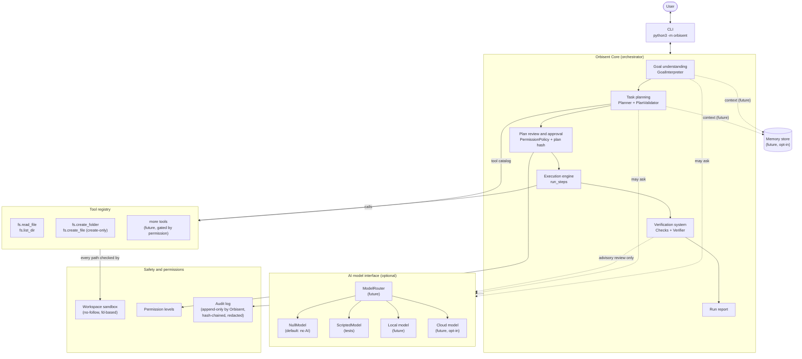
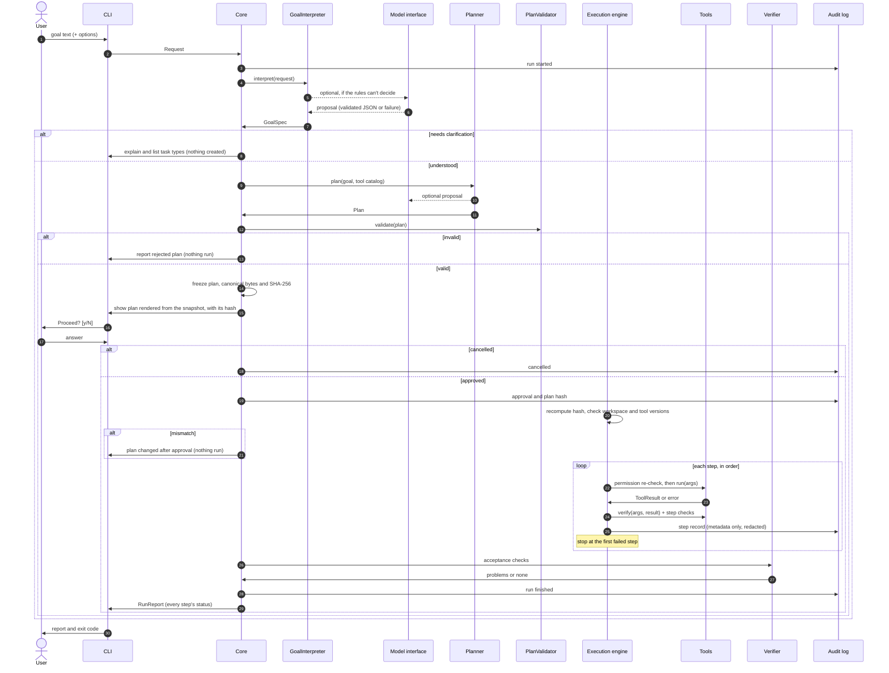

# Orbisent 1.0 — Architecture

*Beyond the Known.*

**Status:** proposal (architecture only, nothing here is implemented yet).
**Starting point:** Prototype 0.3 on `main` (`prototype/`), 58 passing tests.
**Inputs:** [`VISION.md`](VISION.md), [`Prototype.md`](Prototype.md), [`prototype/README.md`](prototype/README.md).

---

## 1. Purpose and scope

Orbisent's long-term goal (VISION.md) is a personal AI companion that turns goals into **completed, verified
results**, inspired by JARVIS. Orbisent 1.0 is **not** that companion yet. It is the foundation that makes one
possible without giving up what the prototypes got right:

- plans are shown before anything happens, and the user approves them,
- every action is verified, and success is only reported when verification passes,
- nothing is deleted or overwritten, and nothing happens behind the user's back,
- the system works, and is fully testable, with **no AI model at all**.

Orbisent 1.0 adds the structure an AI model can later plug into: a model interface, goal understanding,
a planner that can propose plans, a tool registry, a permission system and a verification system.
**An AI model may propose; deterministic code decides, executes and verifies.**

### In scope for 1.0

- A Python package `orbisent/` with the components in §4, using only the standard library.
- Feature parity with Prototype 0.3, re-implemented on the new components.
- A model interface with a "no model" default and a scripted test model. No real model ships in 1.0.
- Local file tools limited to reading and creating inside one workspace folder.

### Out of scope for 1.0 (designed for, not built)

- A real local or cloud model, memory, model routing (interfaces only: §4.9, §4.10).
- Modifying, moving or deleting files, network actions, messages, purchases, calendars, health data.
- Voice, background running, scheduling, reminders, multi-device control.
- Autonomous execution without approval.

---

## 2. What exists today (Prototype 0.3)

| Module | What it does | Reused in 1.0 as |
| --- | --- | --- |
| `prototype/engine.py` | `Step` (description, expected outcome, action, verify, status). `run_steps()` runs steps in order, verifies each one (including skipped steps), and stops at the first failure. Statuses: `pending`, `completed`, `skipped`, `failed`. | **Execution engine** (§4.6): same contract and statuses, ported with its tests. |
| `orbisent_agent.py`: `TASK_TYPES`, `TaskType`, `FileSpec` | Fixed task definitions: keywords, plan sentences, files and their checks. | **Plan templates** (§4.4) and **checks** (§4.7). |
| `orbisent_agent.py`: `classify_goal()` | Whole-word keyword matching. Exactly one match → task; none or several → refuse to guess. | **Rule-based goal interpreter** (§4.3). |
| `orbisent_agent.py`: `folder_step()`, `file_step()` | Create a folder; create a file in mode `"x"`, so it never overwrites. An existing item → `SkipStep`. | **File-system tools** `fs.create_folder` and `fs.create_file` (§4.5). |
| `orbisent_agent.py`: `check_text()`, `verify_file()`, `describe_checks()` | Structural checks: title, required text, minimum counts of checkboxes, steps and sections. A human-readable "Expected:" line. | **Check library** (§4.7). |
| `orbisent_agent.py`: `make_folder_name()` | Reduces a name to `[a-z0-9-]`, which blocks path traversal. | Part of the **workspace sandbox** (§4.8). |
| `orbisent_agent.py`: `main()`, `print_plan()`, `print_report()`, `ask_permission()` | CLI, plan display, confirmation (`--yes` skips it), and an honest report. Exit codes 0/1/2. | **Core** and **CLI** (§4.1). |
| `notebooks/01_train_from_scratch.ipynb` | A tiny character-level language model trained from scratch in Colab. | Unrelated to 1.0 at runtime. It could later be wrapped as a `ModelProvider` for experiments, but it is far too small to understand goals or plan. |

**Preservation rule:** `prototype/` stays as it is, as a frozen, working reference with its own tests.
Orbisent 1.0 lives in a new `orbisent/` package next to it. No existing file is deleted or rewritten by this plan.

---

## 3. Architecture overview



Solid arrows exist in 1.0. Dotted arrows are optional (the model) or future (memory).

### Design principles

1. **Deterministic core, optional intelligence.** Every component has a rule-based implementation.
   A model-based implementation is an alternative behind the same interface, never a requirement.
2. **Model output is untrusted data.** A model can propose a goal interpretation, a plan or a repair.
   It can't call tools, grant permissions or mark anything as verified.
3. **Plans are data, not code.** A plan is a list of tool calls with arguments, validated before it is shown.
4. **One way to act: registered tools.** Tools declare their permission level and how to verify themselves.
5. **Honest reporting.** "Success" means every deterministic check passed. Nothing else counts.
6. **Standard library first.** No third-party dependency in the core. Real model providers come later,
   as optional modules, and preferably talk to models over HTTP with `urllib`.
7. **Small interfaces.** Each component can be tested alone with fakes, as the 0.3 engine is today.

---

## 4. Components

Interfaces below are Python sketches (`typing.Protocol` and `dataclasses`), not final code.
Shared data types are collected in §5.

### 4.1 Orbisent Core

**Responsibility:** run one request end to end: understand → plan → validate → approve → execute → verify → report.
It owns no business logic of its own; it connects the components and enforces their order.

```python
class Orbisent:
    def __init__(self, interpreter, planner, validator, registry, policy, verifier,
                 audit, approver, workspace: Path): ...

    def handle(self, request: Request) -> RunReport:
        goal = self.interpreter.interpret(request)          # GoalSpec, or needs clarification
        if goal.needs_clarification:
            return RunReport.clarification(goal)            # Ask; never guess.
        plan = self.planner.plan(goal, self.registry.catalog())
        problems = self.validator.validate(plan, self.registry, self.policy)
        if problems:
            return RunReport.rejected_plan(plan, problems)  # Nothing was run.
        snapshot = freeze(plan, run_id, workspace_identity)  # Canonical bytes + SHA-256 (§4.8.4)
        approved = self.approver.approve(snapshot, self.policy)  # Shows the plan and its hash first.
        if approved is None:
            return RunReport.cancelled(snapshot)
        records = execute(approved, self.registry, ExecutionContext(...))  # Re-checks the hash first.
        acceptance = self.verifier.verify_outcome(approved, records)
        return RunReport.from_run(goal, approved, records, acceptance)
```

- **`Approver`** is the user-facing part of approval: the CLI prints the plan and asks `y/N`,
  and tests inject answers, as `main(input_func=...)` does today. It returns an `ApprovedPlan` (§4.8.4), not a
  yes/no. Execution only accepts an `ApprovedPlan`, so there is no code path that runs an unapproved plan.
- **CLI:** `python3 -m orbisent "goal" [--task T] [--name N] [--workspace DIR] [--yes] [--dry-run]`,
  with the same exit codes as 0.3 (0 success, 1 cancelled or failed, 2 unclassified or invalid).
  `--dry-run` shows the validated plan and stops.
- **Run IDs:** every request gets a run id, used in the audit log and the report.

### 4.2 AI model interface

**Responsibility:** one small, provider-neutral way to ask a model for **structured** output.
Nothing outside this module knows which model, if any, answered.

```python
@dataclass
class ModelRequest:
    purpose: str            # "interpret_goal" | "propose_plan" | "propose_repair" | "review"
    instructions: str       # Fixed system text written by Orbisent, never by the user.
    input: dict             # Goal text, tool catalog, previous results, ...
    output_schema: dict     # The JSON shape the answer must have.
    privacy: str            # "private" | "shareable": used by routing (§4.10).

@dataclass
class ModelResponse:
    ok: bool
    data: dict | None       # Parsed and schema-validated JSON, or None.
    raw_text: str           # In memory only; not written to the audit log by default (§4.8.6).
    provider: str           # e.g. "none", "scripted", later "local:<name>".
    error: str = ""

class ModelProvider(Protocol):
    name: str
    is_local: bool
    def complete(self, request: ModelRequest) -> ModelResponse: ...
```

- **`NullModel`** (default) always answers `ok=False, error="no model configured"`. Every caller must then fall
  back to rules, which keeps 1.0 fully working with no model.
- **`ScriptedModel`** returns pre-written answers keyed by `purpose`. It is used to test the model-based
  interpreter and planner deterministically, including malformed and malicious answers.
- **Schema validation:** a small validator for a JSON-schema subset (`type`, `properties`, `required`, `enum`,
  `items`, `maxLength`), written with the standard library. Any answer that doesn't parse or validate is
  treated as `ok=False`.
- **Not in 1.0:** real providers. The interface is shaped so that a local HTTP model server or a cloud API can be
  added as one new class each, with no change to callers.

### 4.3 Goal understanding

**Responsibility:** turn free text into a structured `GoalSpec`, or say clearly that it can't.

```python
@dataclass
class GoalSpec:
    text: str                       # Cleaned goal text (0.2 clean_goal).
    task_type: str | None           # e.g. "prepare_project"
    parameters: dict                # e.g. {"project_name": "bakery"}
    confidence: float               # 1.0 for an exact rule match.
    source: str                     # "rules" | "explicit" | "model:<provider>"
    ambiguities: list[str]          # Why it couldn't decide, shown to the user.

    @property
    def needs_clarification(self) -> bool:
        return self.task_type is None

class GoalInterpreter(Protocol):
    def interpret(self, request: Request) -> GoalSpec: ...
```

Implementations, tried in order by a `ChainedInterpreter`:

1. **`ExplicitInterpreter`**: `--task` given → use it (0.2 rule: explicit beats inferred).
2. **`RuleInterpreter`**: the 0.2 `classify_goal()` keyword matcher, unchanged in behaviour.
3. **`ModelInterpreter`** (built in Phase 3, off by default): asks the model to pick **one of the registered
   task types or none**, with parameters. Its answer is accepted only if the task type exists, the parameters
   validate, and the confidence is above a threshold. Otherwise it's treated as ambiguous.

If no step decides, the user gets the 0.2 behaviour: an explanation, the list of task types and a
`--task` example. **Nothing is created on a guess.**

### 4.4 Intelligent task planning

**Responsibility:** turn a `GoalSpec` into a `Plan`, then prove the plan is acceptable before anyone sees it.

```python
@dataclass(frozen=True)
class PlanStep:
    id: str                    # "s1", "s2", ...
    tool: str                  # Registered tool name, e.g. "fs.create_file"
    args: dict                 # Validated against the tool's input schema (JSON-compatible values only).
    description: str           # Shown in the plan.
    expected: str              # Shown as "Expected:"; generated from the tool and its checks.
    checks: tuple[CheckSpec, ...] = ()   # Extra content checks for this step (§4.7).

@dataclass(frozen=True)
class Plan:
    goal: GoalSpec
    steps: tuple[PlanStep, ...]          # Linear in 1.0: run in order, stop at the first failure.
    acceptance: tuple[CheckSpec, ...]    # Goal-level checks run after all steps (§4.7).
    source: str                          # "template:<task>" | "model:<provider>"

class Planner(Protocol):
    def plan(self, goal: GoalSpec, catalog: list[ToolInfo]) -> Plan: ...
```

- **Types:** sequences in a plan are tuples, so their type and default agree (`()` is a valid empty
  `tuple[CheckSpec, ...]`), and the dataclasses are frozen. Checks are stored as data (`CheckSpec`, §4.7), not as
  objects with code, so a plan can be serialised and hashed. `frozen=True` is shallow: `args` is still a `dict`.
  That's why the **approved snapshot**, not the in-memory `Plan`, is what gets executed (§4.8.4).
- **`TemplatePlanner`** (1.0 default): the 0.2/0.3 task types, rewritten as plan templates. `prepare_project` →
  `fs.create_folder` + 3 × `fs.create_file`, with the same text builders and `FileSpec` checks.
  It produces the same steps, expected outcomes and files as 0.3.
- **`ModelPlanner`** (Phase 3, off by default): sends the goal and the **tool catalog** (names, descriptions,
  input schemas, permission levels) to the model and asks for a plan as JSON. If the answer is invalid,
  it falls back to the template for that task type, if one exists. Otherwise it reports that it couldn't plan.
- **`PlanValidator`** runs on **every** plan, whatever its source:
  - every step names a registered tool, and its arguments validate against that tool's schema;
  - every path argument passes the lexical checks of §4.8.1. Paths are resolved only at execution time, through
    the no-follow walk, so validation never relies on a path that could change later;
  - every check is a known `CheckSpec` kind with valid parameters (§4.7);
  - every argument value is JSON-compatible, so the plan can be canonicalised and hashed (§4.8.4);
  - every step's permission level is allowed by the policy;
  - limits: at most N steps (e.g. 50), at most M bytes per file, and no duplicate targets;
  - every step has a non-empty description and an expected outcome.

  A plan that fails validation is reported and **never** shown for approval or run.

"Intelligent" in 1.0 means *the slot exists and is safe*. Plans are template-based until a real model is added
in Phase 4, and the docs must say so.

### 4.5 Tool registry

**Responsibility:** the only way Orbisent can act on the world. Each tool describes itself, runs, and can
verify its own effect.

```python
class Permission(Enum):        # Ordered from least to most risky.
    READ = 1                   # Read inside the workspace.
    CREATE = 2                 # Create new files and folders inside the workspace.
    MODIFY = 3                 # Change existing files (future).
    DELETE = 4                 # Remove anything (future).
    EXTERNAL = 5               # Network, messages, purchases, other apps (future).

@dataclass
class ToolInfo:                # What planners and the model see.
    name: str
    description: str
    input_schema: dict
    permission: Permission

@dataclass
class ToolResult:
    status: str                # "done" | "nothing_to_do" (maps to completed / skipped)
    message: str               # e.g. "Created file: ..."
    data: dict = field(default_factory=dict)

class Tool(Protocol):
    info: ToolInfo
    def preview(self, args: dict, ctx: ExecutionContext) -> str: ...      # For the plan and dry-run.
    def run(self, args: dict, ctx: ExecutionContext) -> ToolResult: ...   # Raises ToolError on failure.
    def verify(self, args: dict, result: ToolResult, ctx: ExecutionContext) -> list[str]: ...

class ToolRegistry:
    def register(self, tool: Tool) -> None: ...      # Duplicate names are an error.
    def get(self, name: str) -> Tool: ...            # Unknown name → KeyError, caught by PlanValidator.
    def catalog(self) -> list[ToolInfo]: ...
```

Tools in 1.0, all sandboxed to the workspace:

| Tool | Permission | Behaviour | Built-in verification |
| --- | --- | --- | --- |
| `fs.create_folder` | CREATE | Creates a folder. An existing folder → `nothing_to_do`. | Path is a folder, and the same folder (device and inode) that was created or found. |
| `fs.create_file` | CREATE | Exclusive create (`O_CREAT \| O_EXCL \| O_NOFOLLOW`): never overwrites. An existing file → `nothing_to_do`. | Path is a regular file, and the same one (device and inode) that was written or found. Step checks then run on its content. |
| `fs.read_file` | READ | Reads UTF-8 text up to a size limit. Refuses non-regular files and secret-looking files (§4.8.6). | Bytes read match the size reported by `fstat` on the same open file. |
| `fs.list_dir` | READ | Lists one folder, not recursively. | Folder exists. |

All four tools reach their targets only through the sandbox's no-follow path walk (§4.8.1), never through a
plain path string.

No tool with MODIFY, DELETE or EXTERNAL is registered in 1.0. The levels exist so that the policy and the plan
display can handle them correctly when such tools arrive.

### 4.6 Execution engine

**Responsibility:** run a validated, approved plan step by step, record every step's status, and stop at the
first failure. It is Prototype 0.3's engine, ported to work with tools.

- **Same contract as `prototype/engine.py`:**
  - statuses `pending` / `completed` / `skipped` / `failed`;
  - verification after every non-failed action, including skipped ones;
  - stop at the first failure, with later steps marked "Not run: step N failed";
  - unexpected exceptions become failed steps, and `KeyboardInterrupt` still stops the run;
  - a finished plan can't be run again.
- **Adapter:** the engine `Step`s are built from the `ApprovedPlan`'s canonical bytes (§4.8.4), not from the
  planner's `Plan` object, after the hash has been re-checked. Each `PlanStep` becomes an engine `Step`.
  - Its `action` re-checks the permission and the step's hash, then calls `tool.run(args, ctx)`.
  - `nothing_to_do` maps to `SkipStep`.
  - Its `verify` runs `tool.verify(...)` plus the step's own checks.
- **`ExecutionContext`:** workspace root, run id, dry-run flag, audit logger, and a clock (injectable for tests).
- **The porting approach:** copy the engine into `orbisent/execution/engine.py` and port
  `prototype/test_engine.py` alongside it, so both versions are proven to behave the same.
  `prototype/` keeps its own copy unchanged.
- **Not in 1.0:**
  - **Retries:** a failed step stops the run.
  - **Automatic repair (Phase 4):** a model may *propose* a repair plan after a failure. That plan goes through
    validation and **new approval**, like any other plan.
  - **Parallel steps and step dependencies:** plans stay a linear list.

### 4.7 Verification system

**Responsibility:** decide, using deterministic checks only, whether each step and the whole goal succeeded.

Verification has four layers:

1. **Tool verification:** each tool checks its own effect (e.g. "the file exists and is a file").
2. **Step checks:** content checks attached to a step. They are the 0.2 `FileSpec` checks, generalised into
   small, composable checks. A plan holds each check as **data** (`CheckSpec`). The verifier turns that data
   into a `Check` object from a fixed list of built-in kinds, so a plan, including one proposed by a model,
   can never carry code:
   ```python
   @dataclass(frozen=True)
   class CheckSpec:
       kind: str                                # "not_empty" | "title_starts_with" | "contains" | "min_count"
       params: tuple[tuple[str, object], ...]   # e.g. (("text", "# Tasks"),); sorted by name.

   class Check(Protocol):
       description: str                         # Used for the "Expected:" line.
       def run(self, text: str) -> list[str]: ...  # Problems; [] means passed.

   def build_check(spec: CheckSpec) -> Check: ...  # Unknown kind or bad params -> rejected by PlanValidator.
   # Built-ins: NotEmpty, TitleStartsWith(t), Contains(s), MinCount(label, regex, n)
   ```
   Regular expressions in `min_count` come only from built-in templates. A model-proposed plan can only choose
   from named patterns (`"checkbox"`, `"numbered_step"`, `"section"`), so it can't supply a regex that hangs
   the program.
3. **Acceptance checks:** goal-level checks run after all steps, e.g. "all three files exist and README lists
   both other files". This catches plans whose steps each succeed but don't achieve the goal together.
4. **Model review** (future, advisory only): a model may comment on quality ("the checklist has no testing
   section"). Its comments appear in the report as notes. **They can never turn a failure into a success.**
   They also can't turn a success into a failure unless a deterministic check agrees.

**Reporting rule (from 0.3):** the run is `SUCCESS` only if no step failed and every acceptance check passed.
The report always lists every step with its status, result and problems, and says which layer found each problem.

### 4.8 Safety and permissions

**Responsibility:** make unsafe actions impossible by construction, and make every risky action visible
and approved.

#### 4.8.1 Workspace sandbox

**Goal:** a tool can only read or create objects inside the workspace, even if paths are hostile (from a model or
a planted file) and even if something changes the file system while Orbisent runs.

**Threat model.**
- **Covered:**
  - hostile path arguments (`..`, absolute paths, odd names);
  - symlinks and hard links planted inside the workspace, for example by an unpacked archive or a cloned repository;
  - another, less-privileged process swapping a folder or file for a symlink between Orbisent's check and its use
    (TOCTOU).
- **Not covered:**
  - a process running as the **same user** or as root. It can change anything Orbisent can, at any moment,
    including after Orbisent has finished.
  - a compromised Python interpreter or operating system.

Orbisent's verification results are therefore true **at the moment they were checked**, and the report says so.

**Why `Path.resolve()` + `is_relative_to` is not enough.** That combination checks a path *string* and then uses
the same string again later. Between the check and the use, any folder on the path can be replaced by a symlink,
so the real target can change (a classic TOCTOU race). It's kept only as a cheap first filter.

**Protections, in order:**

1. **Lexical validation (all platforms, in the `PlanValidator`):**
   - paths are relative, and split into components;
   - reject an empty path, `.`, `..`, absolute paths, drive letters, UNC paths and NUL bytes;
   - reject components longer than 255 bytes, and paths longer than a fixed limit;
   - reject Windows-reserved names (`CON`, `NUL`, `COM1`…) on every platform, so plans are portable;
   - names chosen by the user or a model are cleaned in the style of `make_folder_name()`;
   - duplicate targets are compared case-folded and Unicode NFC-normalised, because macOS and Windows file
     systems are usually case-insensitive.
2. **Pinned workspace root:**
   - The root is resolved once, at the start of the run, and opened as a directory file descriptor
     (`os.open(root, O_RDONLY | O_DIRECTORY)`). The descriptor is held for the whole run.
   - The resolved real path, device and inode are shown in the plan and included in the plan hash (§4.8.4).
   - Orbisent warns if the root is writable by group or other users, since that makes races by other users possible.
3. **No-follow path walk (POSIX):** every intermediate folder is opened relative to its parent's descriptor with
   `os.open(name, O_RDONLY | O_DIRECTORY | O_NOFOLLOW, dir_fd=parent_fd)`. A symlink anywhere on the path makes
   the open fail, and the step **fails**; it is never followed. Because each component is bound to an open
   descriptor, swapping a folder after it was opened has no effect on Orbisent: there's no path string left to
   re-resolve.
4. **Safe final operations, all relative to the parent descriptor:**
   - **Create a file:** `os.open(name, O_WRONLY | O_CREAT | O_EXCL | O_NOFOLLOW, 0o644, dir_fd=fd)`.
     `O_EXCL` fails if *anything* exists at that name, including a symlink or a dangling symlink, so Orbisent
     never writes through a link and never overwrites. That failure maps to `nothing_to_do`, and the existing
     object is then verified via `lstat`, so a symlink in that place fails verification.
   - **Create a folder:** `os.mkdir(name, 0o755, dir_fd=fd)`, then reopen it with `O_NOFOLLOW | O_DIRECTORY`.
   - **Read:** `os.open(name, O_RDONLY | O_NOFOLLOW, dir_fd=fd)`, then `os.fstat` on the open descriptor. The
     read is refused unless the file is a regular file within the size limit. All bytes are read from that same
     descriptor.
5. **Identity checks:**
   - A tool records the `(st_dev, st_ino)` of what it created or found. Verification reopens the target the
     same no-follow way and requires the same identity.
   - A descriptor whose `st_dev` differs from the root's is refused, so the walk never crosses into another
     mounted file system inside the workspace.
6. **Hard links:**
   - Exclusive create never writes into an existing hard link.
   - `fs.read_file` refuses regular files with `st_nlink > 1`, because a hard link inside the workspace can
     point to data outside it.

**Platform limitations:**

| Platform | Strong mode (steps 3–5) | Notes |
| --- | --- | --- |
| Linux | Yes | Uses `dir_fd` and `O_NOFOLLOW`. On Linux 5.6+, `openat2(RESOLVE_BENEATH)` would be stronger still, but the standard library has no wrapper for it, so 1.0 doesn't use it. |
| macOS | Yes | Same calls. File systems are usually case-insensitive, which step 1 handles. |
| Windows | **No** | `os.open` has no `dir_fd` or `O_NOFOLLOW`, and junctions and reparse points behave differently. Only lexical checks and a best-effort `resolve` + `lstat` re-check are possible, with a remaining race. |
| Network file systems (NFS, SMB) | Not guaranteed | `O_EXCL` and `O_NOFOLLOW` may not be atomic. Orbisent warns, and the docs call these unsupported. |

**Decision:** before the first tool runs, Orbisent checks for strong mode
(`os.open in os.supports_dir_fd`, `os.mkdir in os.supports_dir_fd`, and `hasattr(os, "O_NOFOLLOW")`). If strong
mode isn't available, Orbisent **refuses to run tools** unless the user passes `--allow-weak-sandbox`. With that
flag, the plan and the report both state the weaker guarantee.

The default workspace is `orbisent_projects/`, which is git-ignored, as in 0.3.

**Required security tests** (Phase 1 exit criteria). Every test runs in a temporary folder with a sentinel folder
*outside* the workspace, and asserts that nothing in the sentinel changed:

| # | Test | Expected result |
| --- | --- | --- |
| S1 | Absolute path, `..`, `a/../../b`, NUL byte, overlong name, reserved name (`CON`) | Rejected by the validator; nothing run. |
| S2 | Final component is a symlink to a file outside | Create → `nothing_to_do`, then **failed** verification; outside file unchanged. Read → refused. |
| S3 | Final component is a dangling symlink to an outside path | Create fails safely; no file appears at the symlink's target. |
| S4 | Intermediate folder is a symlink to an outside folder | Step fails at the walk; nothing created outside. |
| S5 | Race: a folder is swapped for a symlink **after validation and approval, before the action**, using a deterministic test hook between steps | Step fails; nothing written outside. |
| S6 | Race: a folder is swapped **in the middle of the walk**, using a hook between component opens | The already-open descriptor is used; nothing written outside; verification identity matches the real folder. |
| S7 | Race: the created file is replaced by a different file or a symlink **between action and verification** | Identity check fails; the step is **failed**, not completed. |
| S8 | Hard link inside the workspace to an outside file | Read refused (`st_nlink > 1`); create → `nothing_to_do`; outside file unchanged. |
| S9 | Workspace root given as a symlink | Resolved once; the real path is shown in the plan and hashed. A later swap of the symlink doesn't redirect the run. |
| S10 | A different `st_dev` on the walk (simulated by patching `os.fstat`) | Refused. |
| S11 | Two targets that differ only by case or Unicode normalisation | Rejected as duplicates by the validator. |
| S12 | Strong mode unavailable (simulated by patching `os.supports_dir_fd`) | Tools refused without `--allow-weak-sandbox`; with it, the weaker guarantee is stated in the plan and the report. |

Race tests use injected hooks, not timing or sleeps, so they are deterministic.

#### 4.8.2 Permission policy

| Level | 1.0 policy |
| --- | --- |
| READ | Allowed after plan approval. |
| CREATE | Allowed after plan approval. `--yes` may approve it. |
| MODIFY, DELETE | No tools registered. When added: each step must be confirmed separately, and `--yes` never covers it. DELETE is never auto-approved. |
| EXTERNAL | No tools registered. When added: per-step confirmation, a preview of exactly what will be sent, off by default. |

The policy is checked twice: by the `PlanValidator` before approval, and again by the engine just before each
action, in case a plan is changed after approval. §4.8.4 makes such a change detectable, not just unlikely.

#### 4.8.3 Containment and no hidden actions

- **No hidden actions:** the only side effects are tool calls in the approved plan, plus the audit log.
  The core makes no network calls in 1.0.
- **Model containment:** model text is data. It is never executed, and it is never used as a path without
  validation. It can't add tools, add check code (§4.7) or change permissions. File content read by
  `fs.read_file` and passed to a model is marked as untrusted input, to reduce prompt-injection risk.
- **Secrets:** none in the repository. Future cloud providers read keys from environment variables and are off
  unless the user turns them on. Keys are never placed in a `ModelRequest`, a plan, a report or the audit log.

#### 4.8.4 Approval bound to the exact plan

Approval is not a yes/no flag. It is attached to a **frozen snapshot** of the plan, identified by a hash.
Execution runs the snapshot, never the planner's objects.

1. **Canonical form:** `canonical_plan(plan, run_id, workspace) -> bytes` serialises everything that affects
   what will happen:
   - a format version and the run id (so an approval can't be replayed in another run);
   - the workspace real path, device and inode;
   - for every step, in order: id, tool name and tool version, permission level, `args`, description, expected
     outcome and `CheckSpec`s;
   - the acceptance checks.

   File content to be written is part of `args`, so it is covered. Status fields, timestamps and the model's
   raw text are excluded.

   The encoding is JSON with `sort_keys=True`, `separators=(",", ":")`, `ensure_ascii=False`, all strings
   NFC-normalised, UTF-8 bytes, and no floats. Only `str`, `int`, `bool`, `None`, lists and objects are allowed;
   anything else is a validation error. The same plan therefore always produces the same bytes.
2. **Hash:** `plan_hash = sha256(canonical_bytes)`. The plan display shows its first 12 hex characters
   ("Plan a3f09c1b7e42"), and the full hash is written to the audit log with the approval.
3. **Snapshot:** `ApprovedPlan` is a frozen object holding `canonical_bytes`, `plan_hash`, `run_id`, how it was
   approved (`interactive` or `--yes`) and the policy decisions per step. Only the `Approver` creates one, and
   only after the user agreed to *that* rendering of the plan. The plan shown to the user lists each step's tool, target,
   permission level and expected outcome. It is rendered **from the canonical bytes**, so what is shown is what is
   hashed.
4. **Checks immediately before execution:**
   - The engine recomputes `sha256(canonical_bytes)` and compares it with `plan_hash`.
   - It re-reads the workspace root identity and compares it with the snapshot.
   - It confirms every tool named in the snapshot is still registered with the same version.
   - Any mismatch → the run stops **before the first action**, with "plan changed after approval"; nothing is run.
   - The engine then builds its steps from the canonical bytes (§4.6).
   - Just before each action, the step's own canonical bytes are compared again with the snapshot. This is cheap,
     and it guards against a bug that edits steps during the run.
5. **What needs new approval:** any change to a step, its arguments, its checks, the step order, the workspace or
   a tool version. A repair plan (Phase 4) is a new plan with a new hash. `--yes` doesn't skip the snapshot; it
   only supplies the approval, and it is recorded as `approved_by: "--yes"`.
6. **Scope:** an `ApprovedPlan` is valid only for its run id, within one process. Asynchronous or remote approval
   (e.g. from a phone) is out of scope for 1.0. When added, it would need an expiry time and a signature, which
   need their own design.

What this does and doesn't prove: the hash guarantees that the steps executed are byte-for-byte the steps
approved. It doesn't make the plan itself safe; that's the validator's and the permission policy's job.

#### 4.8.5 Audit log

**What "append-only" means here.** It is a property of **Orbisent's own code**, not something the operating
system enforces:

- one new file per run, `<workspace>/.orbisent/runs/<run_id>.jsonl`, created with `O_CREAT | O_EXCL | O_NOFOLLOW`
  through the sandbox walk (§4.8.1), so an existing log is never reused or overwritten;
- the file is opened with `O_APPEND`, and Orbisent never seeks, truncates, rewrites or deletes a log;
- each record is one JSON object followed by `\n`, written with a single `write` call;
- records are flushed after each write. They are `fsync`ed after the approval record, after any failed step,
  and at the end of the run.

**What it is not.** A JSONL file is **not immutable and not tamper-proof**. Any process running as the same user
(or root) can edit, truncate or delete it, and an attacker who can do that can also rebuild any checksums stored
inside it. Orbisent never describes the log as tamper-proof.

**Integrity checks (tamper-evident against accidents and naive edits):**
- Every record has `seq` (0, 1, 2, …), `run_id`, `time`, `type` and `prev` (the SHA-256 of the previous record's
  exact bytes; the first record uses 64 zeros).
- The first record is `run_started` and the last is `run_finished`, which carries the hash of everything before it.
- The final chain hash is printed in the run report. That gives the user an **external copy**, for example in
  their terminal history or a saved report, to compare against later.
- `python3 -m orbisent audit verify <run_id> [--expect <hash>]` checks that every line parses, `seq` has no gaps,
  every `prev` matches, and the log starts with `run_started`.
  - A log that doesn't end with `run_finished` is reported as **incomplete** (a crash or truncation), not as valid.
  - With `--expect`, it also confirms the final hash matches the copy the user kept.
- This detects disk corruption, partial writes, accidental edits and edits by tools that don't recompute the chain.
  It does **not** detect a deliberate rewrite of the whole chain when no external copy is checked. An HMAC with a
  local key wouldn't change that, because the same user can read the key, so 1.0 doesn't add one.

**"No audit, no action":** if a record can't be written (disk full, permission error), the run stops before
the next action, and the report says that the audit failed.

**Retention:** logs stay until the user removes them. Orbisent itself never deletes them, consistent with
"no deletion". A future explicit `audit purge` command, run only on the user's request and with confirmation, is
the same kind of user-initiated deletion as memory's `forget` (§4.9).

#### 4.8.6 Privacy: what is stored and what is sent

The rule is **minimise first, redact second**. Redaction is a safety net, not a guarantee.

**The audit log stores metadata, not content:**

| Event | Stored | Not stored |
| --- | --- | --- |
| Goal | Goal text, after redaction. | — |
| Plan / approval | Step tools, relative paths, descriptions, expected outcomes, check specs, `plan_hash`, approval method. | File content in `args`: replaced by its length and SHA-256. |
| File created | Relative path, size, SHA-256, device and inode. | The content. |
| File read | Relative path, size, SHA-256. | The content. |
| Step failure | Status and the error message, after redaction. | Stack traces (shown only with `--debug`, which writes nothing extra to the log). |
| Model call | Purpose, provider, local or cloud, time taken, request and response size, SHA-256 of the request and response, whether schema validation passed, and the validated structured result (e.g. the chosen task type). | Instructions, input and the model's raw text, unless the user opts in with `--audit-model-text`, which is redacted and marked in the report. |
| Routing (future) | Provider chosen and the rule that chose it. | — |

The audit folder is created with mode `0o700`, and log files with `0o600` (POSIX).

**Redaction:**
- One `Redactor` runs before anything is written to the audit log, printed in a report, or sent to a
  **non-local** model.
- It replaces matches with `[REDACTED:<kind>]`:
  - private key blocks (`-----BEGIN … PRIVATE KEY-----`);
  - well-known token prefixes (e.g. `sk-`, `ghp_`, `github_pat_`, `AKIA`, `xox`);
  - `Authorization:` and `Bearer` values;
  - `password=` / `token=` / `secret=` style assignments;
  - the current values of environment variables whose names contain `KEY`, `TOKEN`, `SECRET` or `PASSWORD`.
- Redaction is pattern-based and **will** miss some secrets. That's why content isn't logged in the first place.

**Model requests:**
- Send the minimum: the goal text, the tool catalog and the step results the purpose needs.
- File content is sent only when a plan step explicitly reads a file for a model, and the plan shows it
  ("sends README.md, 2 KB, to <provider>").
- Requests marked `privacy="private"` never go to a cloud provider (§4.10).
- `fs.read_file` refuses common secret files by default: `.env`, `.env.*`, `*.pem`, `*.key`, `id_rsa*`,
  `.git/config`, `.netrc` and anything under `.orbisent/`. The audit log is never fed back to a model.
- Model responses are kept in memory only for the run, except for the fields listed in the table above.

**Memory (future):** never filled from audit logs or model responses. Only from items the user approved (§4.9).

### 4.9 Future: memory integration

**Responsibility (future):** remember useful, user-approved context (preferences, projects, decisions) so the
user doesn't repeat themselves (VISION.md §3.5), while staying visible and under the user's control.

```python
@dataclass
class MemoryItem:
    id: str
    kind: str          # "preference" | "project" | "fact" | "decision"
    content: str
    source: str        # Where it came from (run id, user statement).
    created_at: str

class MemoryStore(Protocol):
    def add(self, item: MemoryItem) -> None: ...          # Only after the user agrees.
    def search(self, query: str, limit: int = 5) -> list[MemoryItem]: ...
    def list(self) -> list[MemoryItem]: ...               # The user can see everything stored.
    def forget(self, item_id: str) -> None: ...           # The one deletion Orbisent offers, and only on request.
```

- **Storage:** local first, as a JSON file or `sqlite3` (standard library) inside the workspace.
- **How it's used:** the `GoalInterpreter` and `Planner` get relevant items as context. Memory never triggers an
  action on its own.
- **Nothing is stored silently:** every new memory is proposed in the report and saved only after the user
  approves it.
- **1.0 delivers:** the interface and a `NoMemory` default. Nothing is stored.

### 4.10 Future: local/cloud model routing

**Responsibility (future):** choose which model, if any, answers each `ModelRequest`, balancing privacy,
capability, cost and availability (VISION.md §6 and §8).

```python
class ModelRouter(ModelProvider):            # Callers just see a ModelProvider.
    def __init__(self, providers: list[ModelProvider], policy: RoutingPolicy): ...
    def complete(self, request: ModelRequest) -> ModelResponse: ...
```

Routing rules, in priority order:

1. **Privacy first:** `privacy="private"` requests go only to local providers. With no local provider, use no model.
2. **Simplest that works:** use the rules when they're enough. If the rule interpreter has an exact match,
   no model is asked at all.
3. **Capability:** the provider must support the request's purpose and output size.
4. **Cost and budget:** cloud use is opt-in and has a per-day budget, shown to the user.
5. **Fallback chain:** if a provider fails or returns invalid output, try the next allowed one, then fall back to
   rules or report "couldn't decide".

Every routing decision (provider chosen, and why) is written to the audit log. **1.0 delivers:** nothing beyond
`NullModel` and `ScriptedModel`; the router is built in Phase 6.

---

## 5. Shared data types

All are plain `dataclasses` in `orbisent/types.py`, so they can be printed and compared in tests. Only the
metadata described in §4.8.6 is written to the audit log.

| Type | Main fields | Produced by → used by |
| --- | --- | --- |
| `Request` | `text`, `explicit_task`, `options` | CLI → Core |
| `GoalSpec` | `text`, `task_type`, `parameters`, `confidence`, `source`, `ambiguities` | Interpreter → Planner |
| `Plan` / `PlanStep` | steps (`tool`, `args`, `description`, `expected`, `checks`), `acceptance`, `source`; frozen, sequences are tuples | Planner → Validator → Approver |
| `CheckSpec` | `kind`, `params` (data only, no code) | Planner → Validator → Verifier |
| `ApprovedPlan` | `canonical_bytes`, `plan_hash`, `run_id`, `approved_by`, per-step policy decisions; frozen | Approver → Engine, Verifier, audit log |
| `AuditRecord` | `seq`, `run_id`, `time`, `type`, `prev`, plus type-specific metadata (§4.8.6) | Core, Engine → audit log |
| `ToolInfo` / `ToolResult` | name, schema, permission / status, message, data | Registry ↔ Planner, Tools → Engine |
| `StepRecord` | `step_id`, `status`, `message`, `problems`, `layer` | Engine/Verifier → Report |
| `RunReport` | `run_id`, `outcome` (`success` / `failed` / `cancelled` / `clarification` / `rejected_plan`), records, notes | Core → CLI, audit log |
| `ModelRequest` / `ModelResponse` | §4.2 | Interpreter/Planner ↔ Model interface |

---

## 6. Data flow



---

## 7. Proposed package layout

```
orbisent/                     # New. prototype/ is left untouched.
  __init__.py
  __main__.py                 # python3 -m orbisent
  cli.py                      # Arguments, plan display, approval prompt, report printing
  core.py                     # Orbisent orchestrator (§4.1)
  types.py                    # Shared dataclasses (§5)
  models/
    base.py                   # ModelProvider, ModelRequest, ModelResponse
    null.py                   # NullModel (default)
    scripted.py               # ScriptedModel (tests)
    schema.py                 # Minimal JSON-schema-subset validator
  understanding/
    interpreters.py           # Explicit, Rule, Chained (+ Model in Phase 3)
  planning/
    templates.py              # prepare_project, create_launch_checklist (from 0.2/0.3)
    planner.py                # TemplatePlanner (+ ModelPlanner in Phase 3)
    validator.py              # PlanValidator
    canonical.py              # canonical_plan(), plan hash, ApprovedPlan
  tools/
    base.py                   # Tool, ToolInfo, ToolResult, Permission, ToolError
    registry.py               # ToolRegistry
    filesystem.py             # fs.create_folder, fs.create_file, fs.read_file, fs.list_dir
  execution/
    engine.py                 # Ported from prototype/engine.py
    adapter.py                # PlanStep + Tool -> engine Step
  verification/
    checks.py                 # NotEmpty, TitleStartsWith, Contains, MinCount
    verifier.py               # Step and acceptance verification
  safety/
    sandbox.py                # Pinned root, no-follow fd walk, strong-mode detection
    permissions.py            # PermissionPolicy
    audit.py                  # Hash-chained JSONL audit log + `audit verify`
    redaction.py              # Redactor
  memory/base.py              # MemoryStore interface + NoMemory (Phase 5)
  routing/router.py           # ModelRouter (Phase 6)
tests/                        # unittest, one test module per component
```

Commands once built:

```bash
python3 -m orbisent "Prepare my project folder for launch"
python3 -m unittest discover -s tests -v        # Orbisent 1.0
python3 -m unittest discover -s prototype -v    # Prototype 0.3 (must stay green)
```

---

## 8. Implementation phases

Each phase is one or more small pull requests. A phase is done only when its exit criteria are verified and
**both** test suites pass.

| Phase | Delivers | Exit criteria |
| --- | --- | --- |
| **0. Architecture** (this PR) | This document. | Reviewed and merged. |
| **1. Foundation and parity** | `types`, `tools` (registry + 4 fs tools + sandbox), `execution` (ported engine + adapter), `verification/checks`, `planning/templates` + `TemplatePlanner`, `understanding` (Explicit + Rule), `core`, `cli`. | `python3 -m orbisent` reproduces every documented 0.3 example (same steps, files, statuses and exit codes). Ported engine tests pass. Security tests S1–S12 (§4.8.1) pass on Linux, and on macOS where available. Strong-mode detection refuses weak platforms without `--allow-weak-sandbox`. |
| **2. Safety and audit** | `PermissionPolicy`, `PlanValidator`, canonical plan + `ApprovedPlan`, hash-chained audit log + `audit verify`, `Redactor`, `--dry-run`, acceptance checks. | An invalid plan (unknown tool, path outside the workspace, forbidden level, too many steps, unknown check kind) is rejected before approval, with a test for each. Approval tests A1–A5 and audit/privacy tests L1–L6 (§9) pass. The audit log is written for every run, including cancelled ones. |
| **3. Model interface** | `ModelProvider`, `NullModel`, `ScriptedModel`, schema validator, `ModelInterpreter`, `ModelPlanner` (off by default). | With `NullModel`, behaviour is identical to Phase 2. With `ScriptedModel`, tests cover valid, invalid, malformed and malicious answers (unknown tools, `../` paths, extra permissions), and none of them reaches execution unvalidated. |
| **4. First real model** (optional) | One local provider over HTTP with `urllib` (no new dependency), opt-in. Clarifying questions. Repair proposals after a failure, which need re-approval. | Measured on a fixed set of goals: task-type accuracy, plan validity rate, success rate, and how often the user had to step in (VISION.md §13). Results are recorded honestly, including failures. |
| **5. Memory** | `MemoryStore` with local JSON or `sqlite3`, consent flow, `list`/`forget` commands. | Nothing is stored without approval. The user can list and remove every item. Memory never triggers an action on its own. |
| **6. Model routing** | `ModelRouter`, routing policy, budget, fallback chain. Optional cloud provider. | Private requests never leave the device (tested). Every routing decision is in the audit log. Cloud is off by default. |

New kinds of tool (MODIFY, DELETE, EXTERNAL, calendars, messages) are **not** part of these phases. Each needs
its own design note covering its permission rules, preview and verification before it's built.

---

## 9. Testing strategy

- **Unit tests per component**, with fakes: fake tools for the engine, `ScriptedModel` for interpreters and
  planners, and temporary folders for file tools. This is the pattern 0.3 already uses.
- **Contract tests:** the ported engine must pass the same cases as `prototype/test_engine.py`.
- **Parity tests:** the 0.3 example scenarios run through `orbisent` and produce the same files and exit codes.
- **Safety tests:**
  - every guarantee in §4.8 has a test that tries to break it (overwrite, traversal, symlink escape,
    unapproved permission, a plan changed after approval, a hostile model answer);
  - **sandbox:** S1–S12 in §4.8.1;
  - **approval binding:**
    - **A1:** the same plan always produces the same canonical bytes and hash, including key order and Unicode
      normalisation.
    - **A2:** changing any step field, the step order, a check, the workspace identity or a tool version after
      approval stops the run before the first action.
    - **A3:** a snapshot from one run is refused in another run.
    - **A4:** `--yes` still produces a snapshot and records `approved_by: "--yes"`.
    - **A5:** the displayed plan is rendered from the snapshot.
  - **audit log:**
    - **L1:** `audit verify` accepts an intact log.
    - **L2:** `audit verify` detects an edited record, a removed record, reordered records and a truncated tail
      (reported as incomplete).
    - **L3:** `--expect` detects a fully rebuilt chain.
    - **L4:** a log-write failure stops the run before the next action.
  - **privacy:**
    - **L5:** file content and secrets planted in goals, file content and error messages
      (`sk-…`, `ghp_…`, a private-key block, `password=…`) never appear in the audit log or a report.
    - **L6:** with the default settings, no model instructions, input or raw text are stored;
      `fs.read_file` refuses `.env`, `*.pem` and `.orbisent/` files;
  - mutation checks, as in 0.3: break a safety rule on purpose and confirm a test fails.
- **No network in tests.** Real model providers are tested against a local fake server, or skipped when
  none is available.

---

## 10. Decisions and open questions

Decisions proposed in this document:

1. **A new `orbisent/` package; `prototype/` stays frozen.** This means some duplication, such as the engine.
   It's accepted to keep 0.3 working and to avoid rewriting existing files. The alternative is to turn
   `prototype/` into a thin layer over `orbisent/` later, which changes existing files and needs a separate decision.
2. **Plans are linear in 1.0.** Steps run in order, as in 0.3. Dependency graphs and parallel steps wait until a
   real planner needs them.
3. **The model is advisory.** It never executes, approves or verifies.
4. **Standard library only in the core.** Model providers use `urllib` over HTTP rather than SDKs where possible.
5. **Strong sandbox on POSIX only.** Linux and macOS get the descriptor-based, no-follow sandbox (§4.8.1).
   Other platforms are refused unless the user explicitly accepts a weaker guarantee.
6. **Approval binds to a plan hash.** Execution runs only the approved, frozen snapshot (§4.8.4).
7. **The audit log is tamper-evident, not tamper-proof.** Its hash chain detects corruption and partial edits. A
   deliberate rewrite of the whole log is detected only by comparing it with the final hash the user kept (§4.8.5).
   It stores metadata, not content (§4.8.6).

Open questions for the project owner:

1. **Local model runtime for Phase 4:** which runtime to target first (any server with an HTTP JSON API works with
   this design).
2. **The from-scratch model:** whether the notebook's model line should continue as a research track, separate
   from the agent's planning model.
3. **Workspace location:** is a default of `orbisent_projects/` under the current folder right, or should it be
   a fixed per-user folder?
4. **Which first real-world tool** (after files) Phase 2+ should prepare for, since it decides which permission
   level is designed next.

---

## 11. Honest limitations of Orbisent 1.0

- It is **not** an autonomous AI agent and not yet a JARVIS-like companion. Without a model it is a
  deterministic, rule-based executor with strong safety and verification, as 0.3 is today.
- "Intelligent planning" in 1.0 means a validated slot where a model's plan can be checked and run safely.
  The plans themselves are still templates until a real model is added (Phase 4).
- It only reads and creates local files inside one workspace folder.
- The sandbox can't protect against processes running as the same user or as root. On Windows and network file
  systems, only a weaker, best-effort sandbox is possible.
- The audit log is tamper-evident, not tamper-proof: the same user can rewrite it, and a full rewrite is caught
  only against a final hash kept elsewhere. Its redaction is pattern-based
  and can miss secrets, which is why content isn't logged.
- Verification checks structure and facts, such as files existing and sections present. It can't judge whether
  the content is good; that's what the optional model review is for, and it's advisory only.
- There's no memory, routing, voice, scheduling or integrations in 1.0. Those are designed for, but not built.
