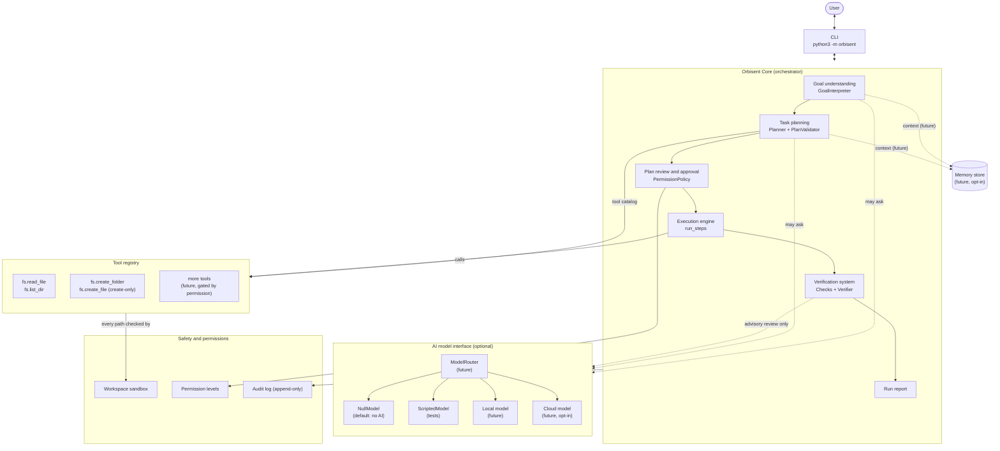
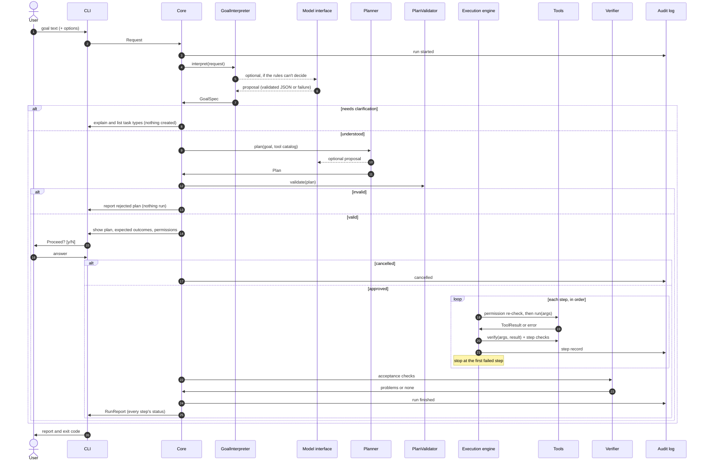

# Orbisent 1.0 — Architecture

*Beyond the Known.*

**Status:** proposal (architecture only, nothing here is implemented yet).
**Starting point:** Prototype 0.3 on `main` (`prototype/`), 58 passing tests.
**Inputs:** [`VISION.md`](VISION.md), [`Prototype.md`](Prototype.md), [`prototype/README.md`](prototype/README.md).

---

## 1. Purpose and scope

Orbisent's long-term goal (VISION.md) is a personal AI companion that turns goals into **completed, verified
results**, inspired by JARVIS. Orbisent 1.0 is **not** that companion yet. It is the foundation that makes one
possible without giving up what the prototypes got right:

- plans are shown before anything happens, and the user approves them,
- every action is verified, and success is only reported when verification passes,
- nothing is deleted or overwritten, and nothing happens behind the user's back,
- the system works, and is fully testable, with **no AI model at all**.

Orbisent 1.0 adds the structure an AI model can later plug into: a model interface, goal understanding,
a planner that can propose plans, a tool registry, a permission system and a verification system.
**An AI model may propose; deterministic code decides, executes and verifies.**

### In scope for 1.0

- A Python package `orbisent/` with the components in §4, using only the standard library.
- Feature parity with Prototype 0.3, re-implemented on the new components.
- A model interface with a "no model" default and a scripted test model. No real model ships in 1.0.
- Local file tools limited to reading and creating inside one workspace folder.

### Out of scope for 1.0 (designed for, not built)

- A real local or cloud model, memory, model routing (interfaces only: §4.9, §4.10).
- Modifying, moving or deleting files, network actions, messages, purchases, calendars, health data.
- Voice, background running, scheduling, reminders, multi-device control.
- Autonomous execution without approval.

---

## 2. What exists today (Prototype 0.3)

| Module | What it does | Reused in 1.0 as |
| --- | --- | --- |
| `prototype/engine.py` | `Step` (description, expected outcome, action, verify, status). `run_steps()` runs steps in order, verifies each one (including skipped steps), and stops at the first failure. Statuses: `pending`, `completed`, `skipped`, `failed`. | **Execution engine** (§4.6): same contract and statuses, ported with its tests. |
| `orbisent_agent.py`: `TASK_TYPES`, `TaskType`, `FileSpec` | Fixed task definitions: keywords, plan sentences, files and their checks. | **Plan templates** (§4.4) and **checks** (§4.7). |
| `orbisent_agent.py`: `classify_goal()` | Whole-word keyword matching. Exactly one match → task; none or several → refuse to guess. | **Rule-based goal interpreter** (§4.3). |
| `orbisent_agent.py`: `folder_step()`, `file_step()` | Create a folder; create a file in mode `"x"`, so it never overwrites. An existing item → `SkipStep`. | **File-system tools** `fs.create_folder` and `fs.create_file` (§4.5). |
| `orbisent_agent.py`: `check_text()`, `verify_file()`, `describe_checks()` | Structural checks: title, required text, minimum counts of checkboxes, steps and sections. A human-readable "Expected:" line. | **Check library** (§4.7). |
| `orbisent_agent.py`: `make_folder_name()` | Reduces a name to `[a-z0-9-]`, which blocks path traversal. | Part of the **workspace sandbox** (§4.8). |
| `orbisent_agent.py`: `main()`, `print_plan()`, `print_report()`, `ask_permission()` | CLI, plan display, confirmation (`--yes` skips it), and an honest report. Exit codes 0/1/2. | **Core** and **CLI** (§4.1). |
| `notebooks/01_train_from_scratch.ipynb` | A tiny character-level language model trained from scratch in Colab. | Unrelated to 1.0 at runtime. It could later be wrapped as a `ModelProvider` for experiments, but it is far too small to understand goals or plan. |

**Preservation rule:** `prototype/` stays as it is, as a frozen, working reference with its own tests.
Orbisent 1.0 lives in a new `orbisent/` package next to it. No existing file is deleted or rewritten by this plan.

---

## 3. Architecture overview



Solid arrows exist in 1.0. Dotted arrows are optional (the model) or future (memory).

### Design principles

1. **Deterministic core, optional intelligence.** Every component has a rule-based implementation.
   A model-based implementation is an alternative behind the same interface, never a requirement.
2. **Model output is untrusted data.** A model can propose a goal interpretation, a plan or a repair.
   It can't call tools, grant permissions or mark anything as verified.
3. **Plans are data, not code.** A plan is a list of tool calls with arguments, validated before it is shown.
4. **One way to act: registered tools.** Tools declare their permission level and how to verify themselves.
5. **Honest reporting.** "Success" means every deterministic check passed. Nothing else counts.
6. **Standard library first.** No third-party dependency in the core. Real model providers come later,
   as optional modules, and preferably talk to models over HTTP with `urllib`.
7. **Small interfaces.** Each component can be tested alone with fakes, as the 0.3 engine is today.

---

## 4. Components

Interfaces below are Python sketches (`typing.Protocol` and `dataclasses`), not final code.
Shared data types are collected in §5.

### 4.1 Orbisent Core

**Responsibility:** run one request end to end: understand → plan → validate → approve → execute → verify → report.
It owns no business logic of its own; it connects the components and enforces their order.

```python
class Orbisent:
    def __init__(self, interpreter, planner, validator, registry, policy, verifier,
                 audit, approver, workspace: Path): ...

    def handle(self, request: Request) -> RunReport:
        goal = self.interpreter.interpret(request)          # GoalSpec, or needs clarification
        if goal.needs_clarification:
            return RunReport.clarification(goal)            # Ask; never guess.
        plan = self.planner.plan(goal, self.registry.catalog())
        problems = self.validator.validate(plan, self.registry, self.policy)
        if problems:
            return RunReport.rejected_plan(plan, problems)  # Nothing was run.
        if not self.approver.approve(plan, self.policy):    # Shows the plan first.
            return RunReport.cancelled(plan)
        records = execute(plan, self.registry, ExecutionContext(...))
        acceptance = self.verifier.verify_outcome(plan, records)
        return RunReport.from_run(goal, plan, records, acceptance)
```

- **`Approver`** is the user-facing part of approval: the CLI prints the plan and asks `y/N`,
  and tests inject answers, as `main(input_func=...)` does today.
- **CLI:** `python3 -m orbisent "goal" [--task T] [--name N] [--workspace DIR] [--yes] [--dry-run]`,
  with the same exit codes as 0.3 (0 success, 1 cancelled or failed, 2 unclassified or invalid).
  `--dry-run` shows the validated plan and stops.
- **Run IDs:** every request gets a run id, used in the audit log and the report.

### 4.2 AI model interface

**Responsibility:** one small, provider-neutral way to ask a model for **structured** output.
Nothing outside this module knows which model, if any, answered.

```python
@dataclass
class ModelRequest:
    purpose: str            # "interpret_goal" | "propose_plan" | "propose_repair" | "review"
    instructions: str       # Fixed system text written by Orbisent, never by the user.
    input: dict             # Goal text, tool catalog, previous results, ...
    output_schema: dict     # The JSON shape the answer must have.
    privacy: str            # "private" | "shareable": used by routing (§4.10).

@dataclass
class ModelResponse:
    ok: bool
    data: dict | None       # Parsed and schema-validated JSON, or None.
    raw_text: str           # Kept for the audit log.
    provider: str           # e.g. "none", "scripted", later "local:<name>".
    error: str = ""

class ModelProvider(Protocol):
    name: str
    is_local: bool
    def complete(self, request: ModelRequest) -> ModelResponse: ...
```

- **`NullModel`** (default) always answers `ok=False, error="no model configured"`. Every caller must then fall
  back to rules, which keeps 1.0 fully working with no model.
- **`ScriptedModel`** returns pre-written answers keyed by `purpose`. It is used to test the model-based
  interpreter and planner deterministically, including malformed and malicious answers.
- **Schema validation:** a small validator for a JSON-schema subset (`type`, `properties`, `required`, `enum`,
  `items`, `maxLength`), written with the standard library. Any answer that doesn't parse or validate is
  treated as `ok=False`.
- **Not in 1.0:** real providers. The interface is shaped so that a local HTTP model server or a cloud API can be
  added as one new class each, with no change to callers.

### 4.3 Goal understanding

**Responsibility:** turn free text into a structured `GoalSpec`, or say clearly that it can't.

```python
@dataclass
class GoalSpec:
    text: str                       # Cleaned goal text (0.2 clean_goal).
    task_type: str | None           # e.g. "prepare_project"
    parameters: dict                # e.g. {"project_name": "bakery"}
    confidence: float               # 1.0 for an exact rule match.
    source: str                     # "rules" | "explicit" | "model:<provider>"
    ambiguities: list[str]          # Why it couldn't decide, shown to the user.

    @property
    def needs_clarification(self) -> bool:
        return self.task_type is None

class GoalInterpreter(Protocol):
    def interpret(self, request: Request) -> GoalSpec: ...
```

Implementations, tried in order by a `ChainedInterpreter`:

1. **`ExplicitInterpreter`**: `--task` given → use it (0.2 rule: explicit beats inferred).
2. **`RuleInterpreter`**: the 0.2 `classify_goal()` keyword matcher, unchanged in behaviour.
3. **`ModelInterpreter`** (built in Phase 3, off by default): asks the model to pick **one of the registered
   task types or none**, with parameters. Its answer is accepted only if the task type exists, the parameters
   validate, and the confidence is above a threshold. Otherwise it's treated as ambiguous.

If no step decides, the user gets the 0.2 behaviour: an explanation, the list of task types and a
`--task` example. **Nothing is created on a guess.**

### 4.4 Intelligent task planning

**Responsibility:** turn a `GoalSpec` into a `Plan`, then prove the plan is acceptable before anyone sees it.

```python
@dataclass
class PlanStep:
    id: str                    # "s1", "s2", ...
    tool: str                  # Registered tool name, e.g. "fs.create_file"
    args: dict                 # Validated against the tool's input schema.
    description: str           # Shown in the plan.
    expected: str              # Shown as "Expected:"; generated from the tool and its checks.
    checks: list[Check] = ()   # Extra content checks for this step (§4.7).

@dataclass
class Plan:
    goal: GoalSpec
    steps: list[PlanStep]      # Linear in 1.0: run in order, stop at the first failure.
    acceptance: list[Check]    # Goal-level checks run after all steps (§4.7).
    source: str                # "template:<task>" | "model:<provider>"

class Planner(Protocol):
    def plan(self, goal: GoalSpec, catalog: list[ToolInfo]) -> Plan: ...
```

- **`TemplatePlanner`** (1.0 default): the 0.2/0.3 task types, rewritten as plan templates. `prepare_project` →
  `fs.create_folder` + 3 × `fs.create_file`, with the same text builders and `FileSpec` checks.
  It produces the same steps, expected outcomes and files as 0.3.
- **`ModelPlanner`** (Phase 3, off by default): sends the goal and the **tool catalog** (names, descriptions,
  input schemas, permission levels) to the model and asks for a plan as JSON. If the answer is invalid,
  it falls back to the template for that task type, if one exists. Otherwise it reports that it couldn't plan.
- **`PlanValidator`** runs on **every** plan, whatever its source:
  - every step names a registered tool, and its arguments validate against that tool's schema;
  - every path argument resolves inside the workspace (§4.8);
  - every step's permission level is allowed by the policy;
  - limits: at most N steps (e.g. 50), at most M bytes per file, and no duplicate targets;
  - every step has a non-empty description and an expected outcome.

  A plan that fails validation is reported and **never** shown for approval or run.

"Intelligent" in 1.0 means *the slot exists and is safe*. Plans are template-based until a real model is added
in Phase 4, and the docs must say so.

### 4.5 Tool registry

**Responsibility:** the only way Orbisent can act on the world. Each tool describes itself, runs, and can
verify its own effect.

```python
class Permission(Enum):        # Ordered from least to most risky.
    READ = 1                   # Read inside the workspace.
    CREATE = 2                 # Create new files and folders inside the workspace.
    MODIFY = 3                 # Change existing files (future).
    DELETE = 4                 # Remove anything (future).
    EXTERNAL = 5               # Network, messages, purchases, other apps (future).

@dataclass
class ToolInfo:                # What planners and the model see.
    name: str
    description: str
    input_schema: dict
    permission: Permission

@dataclass
class ToolResult:
    status: str                # "done" | "nothing_to_do" (maps to completed / skipped)
    message: str               # e.g. "Created file: ..."
    data: dict = field(default_factory=dict)

class Tool(Protocol):
    info: ToolInfo
    def preview(self, args: dict, ctx: ExecutionContext) -> str: ...      # For the plan and dry-run.
    def run(self, args: dict, ctx: ExecutionContext) -> ToolResult: ...   # Raises ToolError on failure.
    def verify(self, args: dict, result: ToolResult, ctx: ExecutionContext) -> list[str]: ...

class ToolRegistry:
    def register(self, tool: Tool) -> None: ...      # Duplicate names are an error.
    def get(self, name: str) -> Tool: ...            # Unknown name → KeyError, caught by PlanValidator.
    def catalog(self) -> list[ToolInfo]: ...
```

Tools in 1.0, all sandboxed to the workspace:

| Tool | Permission | Behaviour | Built-in verification |
| --- | --- | --- | --- |
| `fs.create_folder` | CREATE | Creates a folder. An existing folder → `nothing_to_do`. | Path is a folder. |
| `fs.create_file` | CREATE | Mode `"x"`: never overwrites. An existing file → `nothing_to_do`. | Path is a file; step checks then run on its content. |
| `fs.read_file` | READ | Reads UTF-8 text up to a size limit. | Bytes read match the file size. |
| `fs.list_dir` | READ | Lists one folder, not recursively. | Folder exists. |

No tool with MODIFY, DELETE or EXTERNAL is registered in 1.0. The levels exist so that the policy and the plan
display can handle them correctly when such tools arrive.

### 4.6 Execution engine

**Responsibility:** run a validated, approved plan step by step, record every step's status, and stop at the
first failure. It is Prototype 0.3's engine, ported to work with tools.

- **Same contract as `prototype/engine.py`:**
  - statuses `pending` / `completed` / `skipped` / `failed`;
  - verification after every non-failed action, including skipped ones;
  - stop at the first failure, with later steps marked "Not run: step N failed";
  - unexpected exceptions become failed steps, and `KeyboardInterrupt` still stops the run;
  - a finished plan can't be run again.
- **Adapter:** each `PlanStep` becomes an engine `Step`. Its `action` checks the permission again, then calls
  `tool.run(args, ctx)`; `nothing_to_do` maps to `SkipStep`. Its `verify` runs `tool.verify(...)` plus the
  step's own `checks`.
- **`ExecutionContext`:** workspace root, run id, dry-run flag, audit logger, and a clock (injectable for tests).
- **The porting approach:** copy the engine into `orbisent/execution/engine.py` and port
  `prototype/test_engine.py` alongside it, so both versions are proven to behave the same.
  `prototype/` keeps its own copy unchanged.
- **Not in 1.0:**
  - **Retries:** a failed step stops the run.
  - **Automatic repair (Phase 4):** a model may *propose* a repair plan after a failure. That plan goes through
    validation and **new approval**, like any other plan.
  - **Parallel steps and step dependencies:** plans stay a linear list.

### 4.7 Verification system

**Responsibility:** decide, using deterministic checks only, whether each step and the whole goal succeeded.

Verification has four layers:

1. **Tool verification:** each tool checks its own effect (e.g. "the file exists and is a file").
2. **Step checks:** content checks attached to a step. They are the 0.2 `FileSpec` checks, generalised into
   small, composable `Check` objects:
   ```python
   class Check(Protocol):
       description: str                         # Used for the "Expected:" line.
       def run(self, text: str) -> list[str]: ...  # Problems; [] means passed.
   # Built-ins: NotEmpty, TitleStartsWith(t), Contains(s), MinCount(label, regex, n)
   ```
3. **Acceptance checks:** goal-level checks run after all steps, e.g. "all three files exist and README lists
   both other files". This catches plans whose steps each succeed but don't achieve the goal together.
4. **Model review** (future, advisory only): a model may comment on quality ("the checklist has no testing
   section"). Its comments appear in the report as notes. **They can never turn a failure into a success.**
   They also can't turn a success into a failure unless a deterministic check agrees.

**Reporting rule (from 0.3):** the run is `SUCCESS` only if no step failed and every acceptance check passed.
The report always lists every step with its status, result and problems, and says which layer found each problem.

### 4.8 Safety and permissions

**Responsibility:** make unsafe actions impossible by construction, and make every risky action visible
and approved.

- **Workspace sandbox:**
  - Every path a tool touches is resolved with `Path.resolve()` and must be inside the workspace root
    (`is_relative_to`).
  - Symlinks that point outside the workspace are rejected.
  - Names chosen by the user or a model go through `make_folder_name()`-style cleaning.
  - The default workspace is `orbisent_projects/`, which is git-ignored, as in 0.3.
- **Permission policy:**

  | Level | 1.0 policy |
  | --- | --- |
  | READ | Allowed after plan approval. |
  | CREATE | Allowed after plan approval. `--yes` may approve it. |
  | MODIFY, DELETE | No tools registered. When added: each step must be confirmed separately, and `--yes` never covers it. DELETE is never auto-approved. |
  | EXTERNAL | No tools registered. When added: per-step confirmation, a preview of exactly what will be sent, off by default. |

  The policy is checked twice: by the `PlanValidator` before approval, and again by the engine just before each
  action, in case a plan is changed after approval.
- **Approval:** the full plan, including each step's tool, target, permission level and expected outcome, is
  shown before anything runs. Approval covers that exact plan; any change, including a repair, needs new approval.
- **No hidden actions:** the only side effects are tool calls in the approved plan, plus the audit log.
  The core makes no network calls in 1.0.
- **Model containment:** model text is data. It is never executed, and it is never used as a path without
  validation. It can't add tools or change permissions. File content read by `fs.read_file` and passed to a
  model is marked as untrusted input, to reduce prompt-injection risk.
- **Audit log:** an append-only JSON-lines file per run in `<workspace>/.orbisent/runs/<run_id>.jsonl`, created in
  mode `"x"`. It records the goal, the plan, the approval, each step's result and any model requests and
  responses. It's local only and never uploaded.
- **Secrets:** none in the repository. Future cloud providers read keys from environment variables and are off
  unless the user turns them on.

### 4.9 Future: memory integration

**Responsibility (future):** remember useful, user-approved context (preferences, projects, decisions) so the
user doesn't repeat themselves (VISION.md §3.5), while staying visible and under the user's control.

```python
@dataclass
class MemoryItem:
    id: str
    kind: str          # "preference" | "project" | "fact" | "decision"
    content: str
    source: str        # Where it came from (run id, user statement).
    created_at: str

class MemoryStore(Protocol):
    def add(self, item: MemoryItem) -> None: ...          # Only after the user agrees.
    def search(self, query: str, limit: int = 5) -> list[MemoryItem]: ...
    def list(self) -> list[MemoryItem]: ...               # The user can see everything stored.
    def forget(self, item_id: str) -> None: ...           # The one deletion Orbisent offers, and only on request.
```

- **Storage:** local first, as a JSON file or `sqlite3` (standard library) inside the workspace.
- **How it's used:** the `GoalInterpreter` and `Planner` get relevant items as context. Memory never triggers an
  action on its own.
- **Nothing is stored silently:** every new memory is proposed in the report and saved only after the user
  approves it.
- **1.0 delivers:** the interface and a `NoMemory` default. Nothing is stored.

### 4.10 Future: local/cloud model routing

**Responsibility (future):** choose which model, if any, answers each `ModelRequest`, balancing privacy,
capability, cost and availability (VISION.md §6 and §8).

```python
class ModelRouter(ModelProvider):            # Callers just see a ModelProvider.
    def __init__(self, providers: list[ModelProvider], policy: RoutingPolicy): ...
    def complete(self, request: ModelRequest) -> ModelResponse: ...
```

Routing rules, in priority order:

1. **Privacy first:** `privacy="private"` requests go only to local providers. With no local provider, use no model.
2. **Simplest that works:** use the rules when they're enough. If the rule interpreter has an exact match,
   no model is asked at all.
3. **Capability:** the provider must support the request's purpose and output size.
4. **Cost and budget:** cloud use is opt-in and has a per-day budget, shown to the user.
5. **Fallback chain:** if a provider fails or returns invalid output, try the next allowed one, then fall back to
   rules or report "couldn't decide".

Every routing decision (provider chosen, and why) is written to the audit log. **1.0 delivers:** nothing beyond
`NullModel` and `ScriptedModel`; the router is built in Phase 6.

---

## 5. Shared data types

All are plain `dataclasses` in `orbisent/types.py`, so they can be printed, compared in tests and written to the
audit log as JSON.

| Type | Main fields | Produced by → used by |
| --- | --- | --- |
| `Request` | `text`, `explicit_task`, `options` | CLI → Core |
| `GoalSpec` | `text`, `task_type`, `parameters`, `confidence`, `source`, `ambiguities` | Interpreter → Planner |
| `Plan` / `PlanStep` | steps (`tool`, `args`, `description`, `expected`, `checks`), `acceptance`, `source` | Planner → Validator → Approver → Engine |
| `ToolInfo` / `ToolResult` | name, schema, permission / status, message, data | Registry ↔ Planner, Tools → Engine |
| `StepRecord` | `step_id`, `status`, `message`, `problems`, `layer` | Engine/Verifier → Report |
| `RunReport` | `run_id`, `outcome` (`success` / `failed` / `cancelled` / `clarification` / `rejected_plan`), records, notes | Core → CLI, audit log |
| `ModelRequest` / `ModelResponse` | §4.2 | Interpreter/Planner ↔ Model interface |

---

## 6. Data flow



---

## 7. Proposed package layout

```
orbisent/                     # New. prototype/ is left untouched.
  __init__.py
  __main__.py                 # python3 -m orbisent
  cli.py                      # Arguments, plan display, approval prompt, report printing
  core.py                     # Orbisent orchestrator (§4.1)
  types.py                    # Shared dataclasses (§5)
  models/
    base.py                   # ModelProvider, ModelRequest, ModelResponse
    null.py                   # NullModel (default)
    scripted.py               # ScriptedModel (tests)
    schema.py                 # Minimal JSON-schema-subset validator
  understanding/
    interpreters.py           # Explicit, Rule, Chained (+ Model in Phase 3)
  planning/
    templates.py              # prepare_project, create_launch_checklist (from 0.2/0.3)
    planner.py                # TemplatePlanner (+ ModelPlanner in Phase 3)
    validator.py              # PlanValidator
  tools/
    base.py                   # Tool, ToolInfo, ToolResult, Permission, ToolError
    registry.py               # ToolRegistry
    filesystem.py             # fs.create_folder, fs.create_file, fs.read_file, fs.list_dir
  execution/
    engine.py                 # Ported from prototype/engine.py
    adapter.py                # PlanStep + Tool -> engine Step
  verification/
    checks.py                 # NotEmpty, TitleStartsWith, Contains, MinCount
    verifier.py               # Step and acceptance verification
  safety/
    sandbox.py                # Workspace path resolution
    permissions.py            # PermissionPolicy
    audit.py                  # Append-only JSONL audit log
  memory/base.py              # MemoryStore interface + NoMemory (Phase 5)
  routing/router.py           # ModelRouter (Phase 6)
tests/                        # unittest, one test module per component
```

Commands once built:

```bash
python3 -m orbisent "Prepare my project folder for launch"
python3 -m unittest discover -s tests -v        # Orbisent 1.0
python3 -m unittest discover -s prototype -v    # Prototype 0.3 (must stay green)
```

---

## 8. Implementation phases

Each phase is one or more small pull requests. A phase is done only when its exit criteria are verified and
**both** test suites pass.

| Phase | Delivers | Exit criteria |
| --- | --- | --- |
| **0. Architecture** (this PR) | This document. | Reviewed and merged. |
| **1. Foundation and parity** | `types`, `tools` (registry + 4 fs tools + sandbox), `execution` (ported engine + adapter), `verification/checks`, `planning/templates` + `TemplatePlanner`, `understanding` (Explicit + Rule), `core`, `cli`. | `python3 -m orbisent` reproduces every documented 0.3 example (same steps, files, statuses and exit codes). Ported engine tests pass. Sandbox tests cover traversal, absolute paths and symlinks. |
| **2. Safety and audit** | `PermissionPolicy`, `PlanValidator`, audit log, `--dry-run`, acceptance checks. | An invalid plan (unknown tool, path outside the workspace, forbidden level, too many steps) is rejected before approval, with a test for each. The audit log is written for every run, including cancelled ones. |
| **3. Model interface** | `ModelProvider`, `NullModel`, `ScriptedModel`, schema validator, `ModelInterpreter`, `ModelPlanner` (off by default). | With `NullModel`, behaviour is identical to Phase 2. With `ScriptedModel`, tests cover valid, invalid, malformed and malicious answers (unknown tools, `../` paths, extra permissions), and none of them reaches execution unvalidated. |
| **4. First real model** (optional) | One local provider over HTTP with `urllib` (no new dependency), opt-in. Clarifying questions. Repair proposals after a failure, which need re-approval. | Measured on a fixed set of goals: task-type accuracy, plan validity rate, success rate, and how often the user had to step in (VISION.md §13). Results are recorded honestly, including failures. |
| **5. Memory** | `MemoryStore` with local JSON or `sqlite3`, consent flow, `list`/`forget` commands. | Nothing is stored without approval. The user can list and remove every item. Memory never triggers an action on its own. |
| **6. Model routing** | `ModelRouter`, routing policy, budget, fallback chain. Optional cloud provider. | Private requests never leave the device (tested). Every routing decision is in the audit log. Cloud is off by default. |

New kinds of tool (MODIFY, DELETE, EXTERNAL, calendars, messages) are **not** part of these phases. Each needs
its own design note covering its permission rules, preview and verification before it's built.

---

## 9. Testing strategy

- **Unit tests per component**, with fakes: fake tools for the engine, `ScriptedModel` for interpreters and
  planners, and temporary folders for file tools. This is the pattern 0.3 already uses.
- **Contract tests:** the ported engine must pass the same cases as `prototype/test_engine.py`.
- **Parity tests:** the 0.3 example scenarios run through `orbisent` and produce the same files and exit codes.
- **Safety tests:**
  - every guarantee in §4.8 has a test that tries to break it (overwrite, traversal, symlink escape,
    unapproved permission, a plan changed after approval, a hostile model answer);
  - mutation checks, as in 0.3: break a safety rule on purpose and confirm a test fails.
- **No network in tests.** Real model providers are tested against a local fake server, or skipped when
  none is available.

---

## 10. Decisions and open questions

Decisions proposed in this document:

1. **A new `orbisent/` package; `prototype/` stays frozen.** This means some duplication, such as the engine.
   It's accepted to keep 0.3 working and to avoid rewriting existing files. The alternative is to turn
   `prototype/` into a thin layer over `orbisent/` later, which changes existing files and needs a separate decision.
2. **Plans are linear in 1.0.** Steps run in order, as in 0.3. Dependency graphs and parallel steps wait until a
   real planner needs them.
3. **The model is advisory.** It never executes, approves or verifies.
4. **Standard library only in the core.** Model providers use `urllib` over HTTP rather than SDKs where possible.

Open questions for the project owner:

1. **Local model runtime for Phase 4:** which runtime to target first (any server with an HTTP JSON API works with
   this design).
2. **The from-scratch model:** whether the notebook's model line should continue as a research track, separate
   from the agent's planning model.
3. **Workspace location:** is a default of `orbisent_projects/` under the current folder right, or should it be
   a fixed per-user folder?
4. **Which first real-world tool** (after files) Phase 2+ should prepare for, since it decides which permission
   level is designed next.

---

## 11. Honest limitations of Orbisent 1.0

- It is **not** an autonomous AI agent and not yet a JARVIS-like companion. Without a model it is a
  deterministic, rule-based executor with strong safety and verification, as 0.3 is today.
- "Intelligent planning" in 1.0 means a validated slot where a model's plan can be checked and run safely.
  The plans themselves are still templates until a real model is added (Phase 4).
- It only reads and creates local files inside one workspace folder.
- Verification checks structure and facts, such as files existing and sections present. It can't judge whether
  the content is good; that's what the optional model review is for, and it's advisory only.
- There's no memory, routing, voice, scheduling or integrations in 1.0. Those are designed for, but not built.
